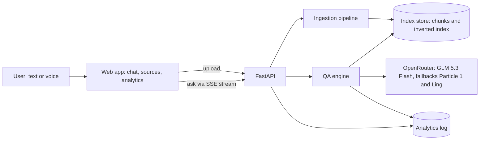
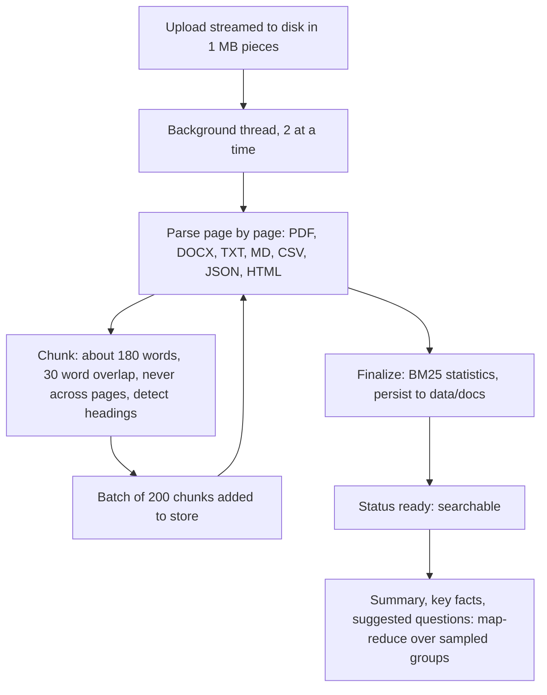
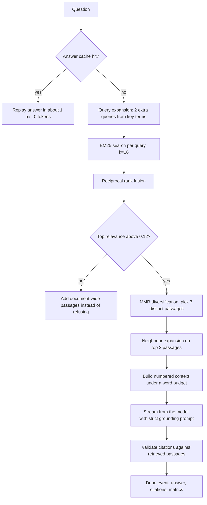
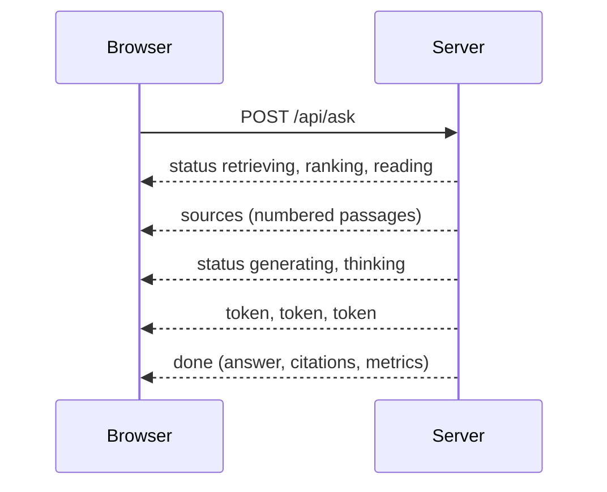

# RagBot architecture

## System overview

## Ingestion (any document size)

## Question answering

## Streaming protocol (server sent events)

## Why it scales
- Memory: pages are streamed, never held as a list. A 500 page PDF peaked at about 26 MB of Python memory.
- Speed: inverted index with packed postings. Search over 50,000 chunks takes 5 to 60 ms.
- Cost: the model always sees about 7 passages, so the prompt size is constant for a 5 page or a 5000 page document.
- Trust: citations are validated, and weak retrieval widens the context, and when the document truly lacks a detail the answer says so plainly.

## Metrics tracked per question
Time to first token, total time, retrieval time, model time, prompt tokens, completion tokens, cached tokens, tokens per second, cache hit, model, passages, answered or not found or error.
